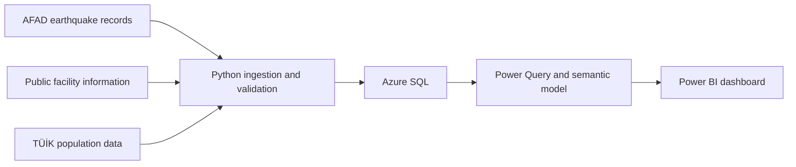

# Turkey Earthquake Analytics
### Business continuity case study · Migros Türkiye

Exploring how earthquake records and public facility locations can support geographic exposure analysis and operational follow-up.

[**Open the existing Power BI dashboard →**](https://app.powerbi.com/view?r=eyJrIjoiZDIxOTNkYjktNGU5OC00MGZkLTkxNmQtMmUyMzc3OGQ0ZGIyIiwidCI6IjQ1NDIwZThkLTg1NTItNGEwMy05YjkyLWE5MzFlZjgzOWQzZiIsImMiOjh9)

> **In development:** The existing dashboard covers earthquake activity. The Migros business-continuity analysis is the next phase.

## The business question

**Following a recorded earthquake, which publicly identified Migros locations should be prioritized for operational status checks?**

Migros operates a geographically distributed retail and logistics network. Its public risk disclosures discuss backup storage, alternative logistics plans, and shifting operations between locations to maintain business continuity.

This independent case study explores how a consolidated analytical view could support that process.

[Read Migros’s public risk disclosures](https://www.migroskurumsal.com/sustainabilityfiles/pdf/2024_risks-and-opportunities.pdf)

## Who would use it?

| Proposed user | Question to answer |
| :--- | :--- |
| Regional operations manager | Which locations fall within the selected screening area? |
| Business-continuity analyst | Where are facilities geographically concentrated? |
| Supply-chain planner | Which other locations warrant investigation as potential support sites? |

These are proposed use cases, not requirements supplied by Migros.

## What the analysis will show

- **Earthquake activity:** recorded events by date, magnitude, depth, and location.
- **Facility proximity:** distances between verified locations and selected earthquake epicenters.
- **Network concentration:** counts and proportions of mapped facilities by region.
- **Population context:** regional population figures with clearly identified reference years.
- **Data quality:** source coverage, coordinate confidence, missing values, and refresh status.

Proximity is a screening measure. It does not confirm damage, safety, or operational availability.

## Why it matters

Combining earthquake records and facility locations can create a repeatable starting point for operational assessment.

The intended benefits are:

1. Less manual work assembling geographic information.
2. More consistent initial status-check briefings.
3. Clearer visibility into facility concentration.
4. Better understanding of missing or uncertain data.

Evaluation will focus on preparation time, data quality, and users’ ability to answer the defined business questions.

## Planned dashboard

| Page | Focus |
| :--- | :--- |
| **01 · Earthquake overview** | Event locations, magnitude, depth, and time filters |
| **02 · Facility exposure** | Selected event, screening radius, and nearby facilities |
| **03 · Network concentration** | Distribution of mapped locations across regions |
| **04 · Data quality** | Coverage, validation results, and refresh status |

## Technical approach

| Tool | Planned responsibility |
| :--- | :--- |
| **Python** | Ingestion, validation, geographic calculations, and automation |
| **Azure SQL** | Validated storage and analytical tables |
| **Power Query** | Report preparation and transformations |
| **DAX** | Measures and filter-aware summaries |
| **Power BI** | Interactive maps and analytical reporting |

### Data model

- **Earthquake events:** one record per source event.
- **Facilities:** one record per verified public location.
- **Date and geography:** shared filtering and classification.
- **Event–facility distances:** relationships supporting proximity analysis.
- **Population:** geographic statistics linked to their reference year.

Store-to-distribution-center relationships will only be included if supported by reliable data.

## Data sources

| Source | Intended use |
| :--- | :--- |
| [AFAD](https://deprem.afad.gov.tr/apiv2/event/filter) | Earthquake timestamps, coordinates, magnitude, and depth |
| [TÜİK](https://data.tuik.gov.tr) | Population context |
| [Migros corporate information](https://www.migroskurumsal.com/en/investor-relations/corporate) | Business context and available facility information |

Facility availability, permitted access, geographic coverage, and update frequency will be verified during implementation.

## Development roadmap

- [ ] Audit the existing earthquake dataset and pipeline
- [ ] Verify public facility-location availability
- [ ] Validate addresses and geographic coordinates
- [ ] Build the SQL model and distance calculations
- [ ] Develop the business-continuity dashboard pages
- [ ] Test measures, filters, and source reconciliation
- [ ] Publish screenshots, setup instructions, and analytical examples

## Scope

This is an **independent public-data portfolio project**, not a commissioned or endorsed Migros solution.

It does not predict earthquakes, estimate building damage, or replace official emergency guidance. Revenue, inventory, capacity, and delivery dependencies are outside the initial scope unless reliable data becomes available. Any synthetic scenarios will be explicitly labeled.
