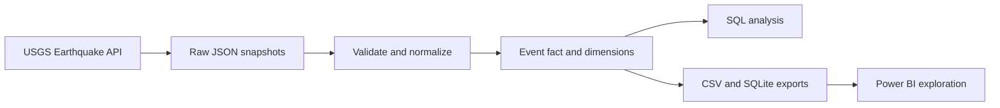

# 🇹🇷 Turkey Earthquake Analytics

### Public earthquake data, transformed into a practical analytics workflow

An end-to-end portfolio project demonstrating how to collect, validate, transform, query, and visualize earthquake catalogue data. The working pipeline uses the USGS Earthquake Catalog API and produces a dimensional dataset for further exploration in SQL and Power BI.

> **Case-study lens:** How could a geographically distributed retailer such as Migros Türkiye use public earthquake information as one input to business-continuity planning? This is an independent portfolio exercise. It does not use verified Migros site data, represent Migros requirements, or imply any affiliation.

---

## The business question

After a significant earthquake, operations teams need a fast way to understand where recorded events occurred and which regions may deserve closer review. Public earthquake data can provide useful situational context, but it does not reveal whether a particular store, warehouse, road, or employee is affected.

This project builds the data foundation for that conversation: a reproducible event dataset, a transparent geographic query scope, and an interactive view of event timing, magnitude, depth, and location. Facility screening is an optional extension that requires separately sourced coordinates.

## What the project does

- Retrieves earthquake events from the USGS catalogue for a documented time window and geographic query rectangle.
- Preserves the raw API responses and source event links for traceability.
- Validates coordinates, timestamps, numeric fields, duplicate IDs, and query-window boundaries.
- Normalizes the event records into a fact table and supporting date and geography tables.
- Runs SQL summaries by source location and magnitude type.
- Exports CSV tables, a SQLite database, data-quality details, and a run manifest.
- Provides Power BI guidance for a map, trend, and magnitude/depth analysis.

## Project flow



## Example analysis

The default notebook query covers **6 February 2023**, with a minimum magnitude of **4.0**, inside a rectangle spanning **25–45°E and 35–43°N**. It is a useful way to inspect the earthquake sequence around southern Türkiye using a known historical period.

The rectangle includes neighboring countries and sea areas, so the results are not Turkey-only. The notebook keeps USGS source location text as supplied and does not infer Turkish province membership from it.

### Suggested Power BI report

Build a clean one-page report with:

| Visual | What it helps answer |
| --- | --- |
| Event count, maximum magnitude, average depth | What is in the selected catalogue window? |
| Map using latitude and longitude, sized by magnitude | Where are the recorded events concentrated? |
| Daily event trend | When were events recorded in the selected period? |
| Magnitude versus depth scatter plot | How do recorded magnitude and depth vary? |
| Date, magnitude type, and source location slicers | How can a reviewer narrow the view? |

Include the query rectangle and catalogue source in the report so viewers understand the geographic and data scope.

## Skills demonstrated

**Python and data engineering:** API requests, bounded retries, response validation, JSON normalization, UTC timestamp handling, deduplication, audit outputs, and deterministic transformations.

**Analytics and modeling:** fact and dimension table design, explicit table grain, keys, SQL CTEs, window functions, and geospatial great-circle distance calculations.

**BI delivery:** Power BI model relationships, explicit Power Query types, report layout, KPI selection, map design, and analytical caveats.

## Technology

`Python` · `Pandas` · `NumPy` · `USGS FDSN API` · `SQLite` · `SQL` · `Jupyter` · `Power BI`

## Run in Google Colab

1. Open `Turkey_Earthquake_Analytics.ipynb` from this repository in Google Colab.
2. Run the cells from top to bottom. The default `MODE = "live"` retrieves the documented USGS window and requires internet access.
3. Review the event table and quality summary, then find the exported model and audit files under `outputs/live_<run_id>/`.

The notebook contains the pipeline functions, so it can run on its own in Colab. For an offline walkthrough using fabricated records, change `MODE` to `"demo"` in the configuration cell. To run locally, install `requirements.txt` and launch Jupyter Lab.

## Repository contents

| File | Purpose |
| --- | --- |
| `Turkey_Earthquake_Analytics.ipynb` | Explained notebook with live USGS ingestion and offline demo mode |
| `pipeline.py` | Reusable extraction, validation, normalization, screening, and export functions |
| `test_pipeline.py` | Deterministic checks using fabricated fixtures |
| `analysis.sql` | Location and magnitude-type summary queries, plus optional proximity analysis |
| `POWER_BI.md` | Data model and report handoff notes |
| `data/facilities_template.csv` | Empty template for future sourced facility coordinates |

Run the local test suite with:

```bash
python -m unittest -v test_pipeline.py
```

## Data quality and scope

- USGS is the live earthquake catalogue in this version. AFAD was explored, but the initial requests in Colab returned empty lists; the notebook does not silently substitute another source.
- The API query count is checked against returned features, and saturated time windows are subdivided instead of silently truncated.
- The raw source response, source URL, event ID, magnitude type, and UTC timestamp are retained for traceability.
- Missing measurements remain missing. Invalid rows are written to a rejection audit, and repeated event IDs are reconciled using source update time.
- Live USGS records are not assigned to Turkish provinces. A point-in-polygon join with a verified boundary dataset would be needed for province-level analysis.
- Facility examples in demo mode are fabricated. Live facility screening is empty unless real coordinates with source and verification metadata are added.

## Limitations

This is a portfolio analytics demonstration, not an emergency-response system. Historical catalogue records cannot predict the timing or magnitude of future earthquakes. A map or distance calculation does not establish shaking intensity, building damage, site safety, road access, or operational status. Facility screening uses straight-line distance, not road distance or a validated impact model.

Azure SQL deployment, TÜİK population enrichment, verified retail facility data, province-boundary analysis, scheduled refresh, and production monitoring are not implemented in this version.

## Data source

- [USGS Earthquake Catalog API](https://earthquake.usgs.gov/fdsnws/event/1/) — live earthquake event records and query documentation.
- [AFAD Earthquake Service](https://deprem.afad.gov.tr/event-service) — investigated as a potential source; not used in the live pipeline currently.
